# analyze.py architecture (Mermaid)

Green = new or changed in this update. Red = blocked for that node. Cylinders = databases.
Paste the code block into https://mermaid.live or any Markdown viewer that supports Mermaid.

```mermaid
flowchart TD
    classDef new fill:#d5e8d4,stroke:#82b366,color:#000
    classDef blocked fill:#f8cecc,stroke:#b85450,color:#000
    classDef mcp fill:#fff,stroke:#333,stroke-width:2px,color:#000
    classDef db fill:#eee,stroke:#333,color:#000

    START([python analyze.py]) --> RA["run_analysis(filename)"]
    RA --> RT["resolve_target(filename)<br/>finds Document hash + primary Company in Neo4j<br/>(must already be ingested by main.py)"]
    RT --> NEO0[(Neo4j)]:::db
    RT --> NAME["asks reviewer name for the audit trail"]
    NAME --> WF["workflow.ainvoke(initial_state)<br/>LangGraph StateGraph + MemorySaver<br/>state: company_id, name, document_hash, reviewer,<br/>review_history, final_score, quant_context, iteration, max_iterations=3"]:::new

    subgraph AUD["AUDITOR NODE  (workflow/nodes/auditor.py)"]
        direction TB
        A1["auditor_node(state)"]
        A2["async with node_toolbox('auditor')<br/>one MCP session; server must have the 3 allowed tools"]:::new
        AL["NODE_TOOL_ALLOWLIST['auditor']<br/>get_company_profile, get_connected_entities,<br/>retrieve_footnote_context"]:::new
        ABL["NOT allowed (PermissionError)<br/>get_debt_ratios, calculate_graph_centrality,<br/>save_risk_assessment"]:::blocked
        A3["profile = tools.call get_company_profile<br/>plain code, no LLM"]:::new
        A4["connections = tools.call get_connected_entities hops=2<br/>plain code, no LLM"]:::new
        M1["MCP tool: get_company_profile<br/>structure only: id, name, description, relationship_count<br/>NO risk fields"]:::new
        M2["MCP tool: get_connected_entities"]:::mcp
        A5["_format_profile + _format_connections<br/>max 40 lines"]:::new
        A6["auditor_prompt = AUDITOR_SYSTEM_PROMPT.format<br/>company_name, company_id, profile_block, connections_block<br/>no risk score shown, ONE tool, max 3 uses"]:::new
        A7["search_tool = make_document_search_tool(tools, document_hash)<br/>model picks ONLY the query<br/>document_hash and top_k=3 fixed in code"]:::new
        A8["agent = create_react_agent(get_llm(), search_tool)<br/>bound tools: search_this_document ONLY"]:::new
        A9["agent.ainvoke(messages=prompt, recursion_limit=12)<br/>LLM: groq gpt-oss-20b, fallback gemini-flash"]:::new
        A10{"LLM turn:<br/>needs more text<br/>from the report?"}:::new
        A11["search_this_document(query)<br/>= tools.call retrieve_footnote_context<br/>query, document_hash LOCKED, top_k=3"]:::new
        M3["MCP tool: retrieve_footnote_context<br/>document_hash REQUIRED, top_k max 10"]:::new
        A12["search_chunks(query, top_k, document_hash)<br/>embed_text -> query_points cosine + hash filter"]
        A13["findings = strip_think(last message)<br/>split lines, strip bullets<br/>return auditor_findings"]:::new

        A1 --> A2
        AL -.checked on every call.-> A2
        ABL -.blocked.-> A2
        A2 --> A3 --> M1
        A3 --> A4 --> M2
        A4 --> A5 --> A6 --> A7 --> A8 --> A9 --> A10
        A10 -- yes: tool call --> A11 --> M3 --> A12
        A12 -. tool result back to the LLM .-> A9
        A10 -- no: final answer --> A13
    end
    M1 --> NEO1[(Neo4j)]:::db
    M2 --> NEO1
    A12 --> QD1[(Qdrant)]:::db

    WF --> A1
    A13 -- auditor_findings --> Q1

    subgraph QNT["QUANT NODE  (workflow/nodes/quant.py)  now goes through MCP too"]
        direction TB
        Q1["quant_node(state)<br/>iteration += 1; rescoring = iteration > 1"]
        Q2["async with node_toolbox('quant')<br/>one MCP session; server must have the 4 allowed tools"]:::new
        QAL["NODE_TOOL_ALLOWLIST['quant']<br/>get_debt_ratios, calculate_graph_centrality,<br/>retrieve_footnote_context, save_risk_assessment"]:::new
        QBL["NOT allowed (PermissionError)<br/>get_company_profile, get_connected_entities"]:::blocked
        Q3["history = tools.call get_debt_ratios company_id"]:::new
        MD["MCP tool: get_debt_ratios<br/>now returns document_hash, filename,<br/>final_risk_level, overridden"]:::new
        Q4["existing = entry for THIS document<br/>others = earlier years"]:::new
        Q5{"existing and<br/>not rescoring?"}:::new
        Q6["reuse: score from existing<br/>no search, no LLM, no write"]:::new
        subgraph CALC["_calculate_score(tools, state, hint)"]
            direction TB
            C1["queries = metric_queries(hint)<br/>5 fixed queries + analyst hint"]:::new
            C2["for each query: tools.call retrieve_footnote_context<br/>document_hash locked, top_k=3"]:::new
            MR["MCP tool: retrieve_footnote_context"]:::new
            C3["context = merge_unique(chunk_texts)"]:::new
            C4["extract_financial_metrics via asyncio.to_thread<br/>metrics prompt + LLM + pydantic parser -> FinancialMetrics"]:::new
            C5["compute_risk_score<br/>pure arithmetic rules -> LOW / MEDIUM / HIGH / UNKNOWN"]
            C6["tools.call save_risk_assessment<br/>company_id, document_hash, level, ratios, notes"]:::new
            MS["MCP tool: save_risk_assessment<br/>graph.writer.save_risk_assessment<br/>MERGE RiskAssessment, ON CREATE status=DRAFT<br/>system ratios only, never final_*"]:::new
            C1 --> C2 --> MR
            MR --> C3 --> C4 --> C5 --> C6 --> MS
        end
        Q7["top = tools.call calculate_graph_centrality limit=100<br/>rank, degree of this company"]:::new
        MC["MCP tool: calculate_graph_centrality<br/>plain Cypher degree count"]:::new
        Q8["return risk_score, iteration, rerun_hint=None,<br/>quant_context = prior_assessments (max 5, approved level),<br/>centrality {rank, degree, top_n}<br/>+ rescore review event when iteration > 1"]:::new

        Q1 --> Q2
        QAL -.checked on every call.-> Q2
        QBL -.blocked.-> Q2
        Q2 --> Q3 --> MD
        Q3 --> Q4 --> Q5
        Q5 -- yes --> Q6 --> Q7
        Q5 -- no: new document or analyst re-run --> C1
        MS --> Q7
        Q7 --> MC
        Q7 --> Q8
    end
    MD --> NEO2[(Neo4j)]:::db
    MS --> NEO2
    MC --> NEO2
    MR --> QD2[(Qdrant)]:::db

    Q8 --> H1

    subgraph HIT["HUMAN REVIEW  (workflow/nodes/hitl.py + analyze.py)"]
        direction TB
        H1["hitl_node(state)<br/>interrupt payload: company_name, auditor_findings,<br/>risk_score, final_score, quant_context, iteration,<br/>reruns_left, review_history"]:::new
        H2["analyze.py prompt_human(payload)<br/>shows findings, system score, override, review so far"]
        H3["_show_quant_context<br/>earlier assessments + graph position<br/>(context only, not in the score)"]:::new
        H4{"analyst choice"}
        H5["approve: event approve -> writer"]
        H6["override: _ask_overrides -> apply_override<br/>ratios typed, level recalculated<br/>-> back to hitl to confirm"]
        H7["rerun: hint stored, final_score cleared<br/>-> quant again (max_iterations = 3)"]
        H1 --> H2 --> H3 --> H4
        H4 -- a --> H5
        H4 -- o --> H6 --> H1
        H4 -- r --> H7
    end
    H7 --> Q1

    H5 --> W1

    subgraph WRT["WRITER NODE  (workflow/nodes/writer.py)"]
        direction TB
        W1["writer_node(state)<br/>final_score = analyst override or system score"]
        W2["WRITER_PROMPT + get_extraction_llm -> report text"]
        W3["WRITE_APPROVAL_QUERY<br/>status, approved_by, overridden, final_* on RiskAssessment"]
        W4["WRITE_REVIEW_EVENTS_QUERY<br/>one ReviewEvent node per audit-trail entry"]
        W5["ApprovalRecord -> build_risk_report_pdf"]
        W1 --> W2 --> W3 --> W4 --> W5
    end
    W3 --> NEO3[(Neo4j)]:::db
    W4 --> NEO3
    W5 --> PDF[/"risk_report PDF"/]
    W5 --> DONE([END: analyze.py prints decision, final score, review history])
```

